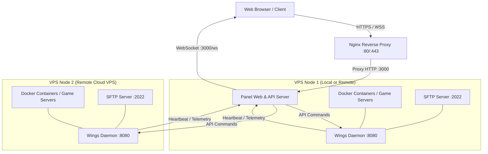

# 🚀 SMOOTH x HOST - VPS Hosting & Wings Installation Guide

> **Enterprise Game Server & Application Management Panel**  
> Complete manual for hosting the panel, connecting remote VPS nodes via 1-line bash commands (identical to `pterodactyl-installer.se`), configuring Nginx reverse proxy, and securing with free Let's Encrypt SSL.

---

## 📑 Table of Contents
1. [Architecture Overview](#-architecture-overview)
2. [1-Line VPS Quick Installation](#-1-line-vps-quick-installation)
3. [How to Host on Any Cloud VPS](#-how-to-host-on-any-cloud-vps)
4. [Connecting Remote VPS Nodes (Wings Daemon)](#-connecting-remote-vps-nodes-wings-daemon)
5. [Firewall & Port Requirements](#-firewall--port-requirements)
6. [Domain & Let's Encrypt SSL Setup](#-domain--lets-encrypt-ssl-setup)
7. [Systemd Service Management](#-systemd-service-management)
8. [Features Checklist](#-features-checklist)

---

## 🏛 Architecture Overview

SMOOTH x HOST follows the industry-standard decoupled architecture popularized by Pterodactyl:



- **Panel**: Built with Node.js, Express, and modern glassmorphism frontend. Serves the web UI, REST API, WebSocket event bus, and the auto-installer script.
- **Wings Daemon**: Lightweight node agent (`wings-daemon.js`) installed on remote compute VPS machines. Communicates host telemetry (CPU, RAM, Docker container counts) back to the panel and runs isolated server instances.
- **WebSocket Gateway**: Real-time bidirectional streaming for server console logs, ANSI color parsing, and live resource graphs.

---

## ⚡ 1-Line VPS Quick Installation

Just like `bash <(curl -s https://pterodactyl-installer.se)`, you can install and configure the entire stack on any Linux VPS with a **single command**:

### Interactive Installation Menu
Log into your VPS via SSH as `root` (or with `sudo`) and run:

```bash
bash <(curl -sSL http://YOUR_PANEL_IP:3000/install.sh)
```
*(Replace `YOUR_PANEL_IP:3000` or use your domain name `https://panel.yourdomain.com/install.sh`)*

You will be greeted with an interactive CLI banner and menu:
```text
  ███████╗███╗   ███╗ ██████╗  ██████╗ ████████╗██╗  ██╗
  ██╔════╝████╗ ████║██╔═══██╗██╔═══██╗╚══██╔══╝██║  ██║
  ███████╗██╔████╔██║██║   ██║██║   ██║   ██║   ███████║
  ╚════██║██║╚██╔╝██║██║   ██║██║   ██║   ██║   ██╔══██║
  ███████║██║ ╚═╝ ██║╚██████╔╝╚██████╔╝   ██║   ██║  ██║
  ╚══════╝╚═╝     ╚═╝ ╚═════╝  ╚═════╝    ╚═╝   ╚═╝  ╚═╝
   Enterprise Game & Application Server Management Panel
   Automated VPS Cloud Deployer • Wings Daemon Connector
===================================================================

Please select an installation action:

  [1] Install SMOOTH x HOST Panel (Web UI, API, Core Engine)
  [2] Install Wings Node Daemon (Connect this VPS to a Panel)
  [3] Install Both Panel + Wings (All-in-One on this VPS)
  [4] Configure Nginx Reverse Proxy with Free Let's Encrypt SSL
  [5] View Running Services & Diagnostics
  [6] Exit
```

---

## 🌐 How to Host on Any Cloud VPS

### 1. Supported Operating Systems
- **Ubuntu**: 20.04 LTS, 22.04 LTS, 24.04 LTS *(Recommended)*
- **Debian**: 11 (Bullseye), 12 (Bookworm)
- **RHEL-based**: AlmaLinux 8/9, Rocky Linux 8/9, CentOS Stream 9

### 2. Supported VPS Providers
Any cloud or bare-metal provider works out of the box:
- **Oracle Cloud** (Always Free Ampere A1 ARM 4 OCPU / 24 GB RAM or AMD E2)
- **DigitalOcean** (Basic Droplets or CPU-Optimized)
- **Hetzner Cloud** (CX22 / CPX series)
- **Contabo** (Cloud VPS)
- **Linode / Akamai**
- **Vultr**
- **AWS EC2** / **Google Cloud Compute Engine**
- **Home Lab / Proxmox / KVM**

### 3. Step-by-Step VPS Setup

#### Step 1: Connect to your VPS via SSH
```bash
ssh root@YOUR_SERVER_IP
```

#### Step 2: Download or Clone the Panel Repository
```bash
cd /var/www
git clone https://github.com/smooth-x-host/ptro-panel.git smooth-panel
cd smooth-panel
```
*(Or upload the project files directly to `/var/www/smooth-panel` using SFTP/SCP)*

#### Step 3: Run the Auto-Installer
```bash
chmod +x install.sh
sudo ./install.sh
```
Select **Option [1]** to install the panel, or **Option [3]** if this VPS will also host game servers (All-in-One).

The installer will automatically:
1. Update system package repositories (`apt` or `dnf`).
2. Install Node.js 20 LTS runtime and required build tools.
3. Install Docker Engine and enable container virtualization.
4. Install all production dependencies via `npm install --production`.
5. Create and enable the `smooth-panel.service` systemd service for 24/7 background operation.
6. Open required firewall ports in `ufw` or `firewalld`.

---

## 🦅 Connecting Remote VPS Nodes (Wings Daemon)

You can scale to dozens of VPS nodes across multiple data centers (e.g. US, Europe, Asia) and manage all game servers from a single web dashboard.

### Method A: Auto-Deploy 1-Click Command (Fastest)

1. Open your SMOOTH x HOST Panel in your browser (`http://YOUR_PANEL_IP:3000`).
2. Navigate to **Admin Area** (shield icon in the top header) -> **Nodes**.
3. Locate the node you wish to connect (or click **+ Create Node** to create a new one).
4. Click the **Auto-Deploy** button on the node card.
5. An interactive modal will appear with your unique node token and a pre-configured command:

```bash
curl -sSL http://YOUR_PANEL_IP:3000/install.sh | sudo bash -s -- --wings --panel-url http://YOUR_PANEL_IP:3000 --node-id node-us-east --token YOUR_TOKEN
```

6. Open an SSH terminal on your **remote VPS node** and paste the command.
7. The installer will:
   - Install Node.js and Docker automatically.
   - Write `/etc/pterodactyl/config.yml`.
   - Setup and launch `smooth-wings.service`.
   - Send an immediate registration heartbeat to the panel.
8. Look at your panel: The node will instantly switch from **Offline (Red)** to **Online (Green)**, streaming live CPU, RAM, and container statistics!

---

### Method B: Manual Wings Configuration

If you prefer to configure manually or are integrating with standard Pterodactyl Wings:

1. In **Admin -> Nodes**, click **Configuration** on the node.
2. Copy the generated YAML block:
```yaml
debug: false
uuid: node-us-east
token: smooth_token_example123
api:
  host: 0.0.0.0
  port: 8080
  ssl:
    enabled: false
  upload_limit: 100
system:
  root_directory: /var/lib/pterodactyl
  log_directory: /var/log/pterodactyl
  data: /var/lib/pterodactyl/volumes
  sftp:
    bind_port: 2022
allowed_mounts: []
remote: http://YOUR_PANEL_IP:3000
```
3. On your remote VPS, paste this to `/etc/pterodactyl/config.yml`.
4. Run the Wings daemon:
```bash
node wings-daemon.js --panel-url http://YOUR_PANEL_IP:3000 --node-id node-us-east --token smooth_token_example123
```

---

## 🔒 Firewall & Port Requirements

Ensure the following ports are permitted in your hosting provider's cloud firewall (e.g., Oracle Security Lists, AWS Security Groups, or DigitalOcean Cloud Firewalls):

| Port | Protocol | Target | Description |
| :--- | :--- | :--- | :--- |
| **80** | TCP | Panel / Nginx | HTTP Web Traffic & Let's Encrypt validation |
| **443** | TCP | Panel / Nginx | HTTPS Secure Web & WSS WebSocket |
| **3000** | TCP | Panel Direct | Default internal web port (can be proxied) |
| **8080** | TCP | Wings Node | Wings Daemon HTTP API |
| **2022** | TCP | Wings Node | SFTP File Access for Server Managers |
| **25565 - 25600** | TCP/UDP | Wings Node | Game allocations (Minecraft, CS:GO, Rust, FiveM, etc.) |

### UFW Commands (Ubuntu/Debian)
```bash
# On Panel VPS:
sudo ufw allow 22/tcp
sudo ufw allow 80/tcp
sudo ufw allow 443/tcp
sudo ufw allow 3000/tcp
sudo ufw enable

# On Wings Compute VPS:
sudo ufw allow 22/tcp
sudo ufw allow 8080/tcp
sudo ufw allow 2022/tcp
sudo ufw allow 25565:25600/tcp
sudo ufw allow 25565:25600/udp
sudo ufw enable
```

---

## 🔐 Domain & Let's Encrypt SSL Setup

To run on a custom domain (e.g., `panel.yourdomain.com`) with a free green padlock SSL:

1. Create a **DNS A-Record** at your domain registrar pointing to your Panel VPS IP:
   - Host: `panel` (or `@`)
   - Type: `A`
   - Value: `YOUR_PANEL_VPS_IP`
2. Run the installer script on your Panel VPS:
   ```bash
   sudo ./install.sh
   ```
3. Choose **Option [4] Configure Nginx Reverse Proxy with Free Let's Encrypt SSL**.
4. Enter your domain name (`panel.yourdomain.com`) and your email address.
5. The script automatically generates the Nginx configuration with WebSocket reverse proxy support (`/ws`) and invokes Certbot to issue and bind your Let's Encrypt SSL certificate!

---

## 🛠 Systemd Service Management

The panel and wings run as native Linux systemd services for zero-downtime reliability:

### Panel Service (`smooth-panel`)
```bash
# Check status
sudo systemctl status smooth-panel

# Restart panel
sudo systemctl restart smooth-panel

# View live application logs
sudo journalctl -u smooth-panel -f
```

### Wings Daemon Service (`smooth-wings`)
```bash
# Check status
sudo systemctl status smooth-wings

# Restart daemon
sudo systemctl restart smooth-wings

# View live telemetry logs
sudo journalctl -u smooth-wings -f
```

---

## 🎮 Features Checklist

| Feature | Status | Details |
| :--- | :---: | :--- |
| **Terminal Console** | ✅ | Live ANSI color streaming, command dispatch, sparkline CPU/RAM charts |
| **File Manager** | ✅ | Mass select, upload, download, compress (`.zip`/`.tar.gz`), extract, chmod |
| **Database Center** | ✅ | Create databases, rotate passwords, remote host assignment |
| **Schedules & Cron** | ✅ | Multi-action execution pipelines, minute/hour/day cron scheduler |
| **Subusers & RBAC** | ✅ | 8 categorized permission sets with select/deselect all toggles |
| **Backups** | ✅ | Create, lock against deletion, restore, and S3 cloud storage flags |
| **Network Manager** | ✅ | Assign/remove secondary allocations, primary port toggling |
| **Startup Options** | ✅ | Select Docker images (Java 17/21, Node.js, Python), edit env flags |
| **Server Migration** | ✅ | 1-click server transfer wizard across different nodes |
| **Node Manager** | ✅ | Auto-deploy 1-line curl commands, cluster health overview |
| **Eggs & Nests** | ✅ | Minecraft, Rust, CS:GO, FiveM, Node.js, Python, TS3 |
| **Security & 2FA** | ✅ | Authenticator SVG QR codes, TOTP verify, API Keys, SFTP SSH keys |
| **Audit Logs** | ✅ | Real-time security and administration activity logs |

---

*SMOOTH x HOST - Built with precision for modern server administrators.*
